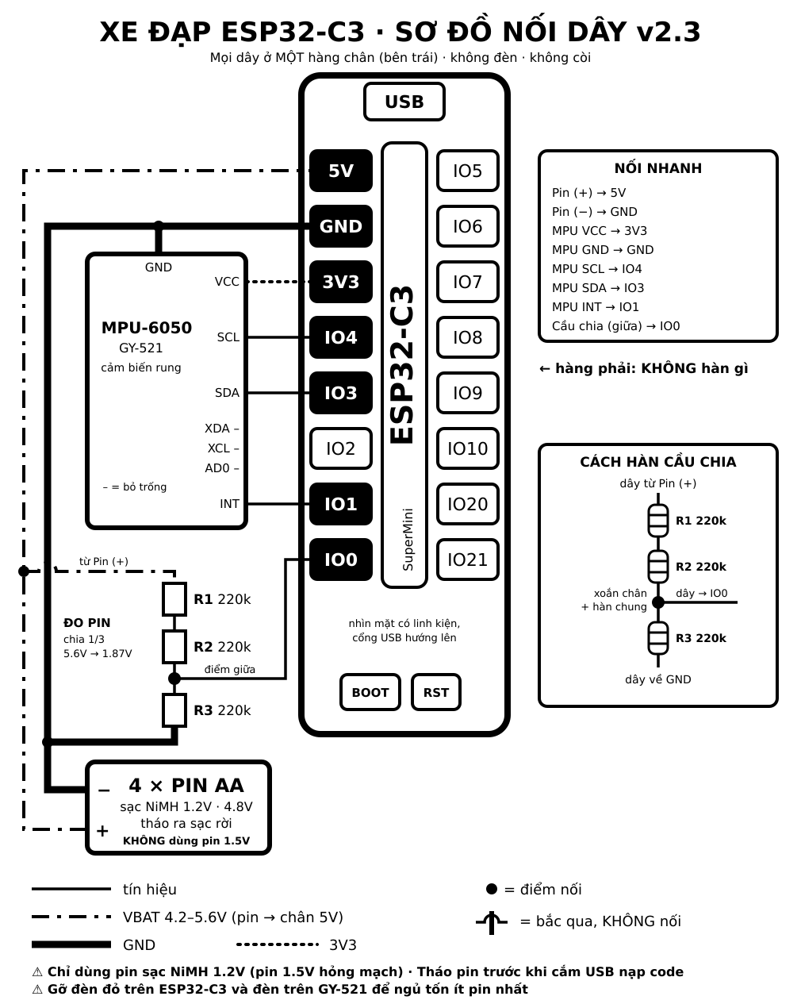

# XeDap Guard v3.2 – Báo mất xe đạp qua Bluetooth (ESP32-C3), bản tiết kiệm pin

ESP32-C3 gắn trên xe đạp phát Bluetooth. Điện thoại kết nối và **báo động khi xe bị rung, ra xa hoặc mất kết nối**.
Mạch **không có đèn, không có còi** (để trong hộp kín chống nước). Khi không dùng thì mạch **ngủ**; **lắc xe** để đánh thức.

```
firmware/XeDap/XeDap.ino   Firmware (nạp bản này)
firmware/XeGuard/XeGuard.ino  Bản cũ XeGuard v1.0, chỉ để tham khảo (không nạp)
xedap.html                 Trang web điện thoại (GitHub Pages)
manifest.json, icon-*.png  Để cài trang web như ứng dụng trên điện thoại
diagrams/xedap-so-do-noi-day.svg (.png)  Sơ đồ nối dây
```

## Phần cứng

| Linh kiện | Ghi chú |
|---|---|
| ESP32-C3 SuperMini | Gỡ đèn đỏ trên mạch (gần cổng USB) để ngủ đỡ tốn pin. Đèn xanh (IO8) firmware tự tắt |
| 4 viên pin sạc **NiMH 1.2V** (AA, nên loại ít tự xả như Eneloop) + đế 4 viên | Tháo ra sạc rời. **KHÔNG dùng pin kiềm 1.5V** (4 viên = 6.4V, hỏng mạch) |
| 3 điện trở 220k | Đo % pin (cầu chia 1/3) |
| MPU-6050 (bo GY-521 / SY-151; chip MPU-6500 cũng được) | Cảm biến rung. Gỡ đèn LED trên bo. **Nhớ hàn hàng chân** |
| Hộp nhựa kín | Không dùng hộp kim loại (chặn Bluetooth). Gắn chặt hộp vào khung xe |

## Nối dây – mọi dây ở hàng chân trái (5V GND 3V3 IO4 IO3 IO2 IO1 IO0)



Nhìn mặt có linh kiện, cổng USB hướng lên. **Hàng chân phải không hàn gì.**

| Từ | Đến chân ESP32-C3 |
|---|---|
| Pin (+) | **5V** |
| Pin (−) | **GND** |
| MPU VCC | **3V3** |
| MPU GND | **GND** |
| MPU SCL | **IO4** |
| MPU SDA | **IO3** |
| MPU INT | **IO1** |
| Điểm giữa cầu chia | **IO0** |
| MPU XDA, XCL, AD0 – chân IO2 | Bỏ trống |

```
Pin (+) ──────┬────────────── 5V
            220k (R1)
            220k (R2)
              ├────────────── IO0
            220k (R3)
Pin (−) ──────┴────────────── GND
```

- **Nối pin vào chân 5V, KHÔNG nối vào 3V3.**
- **Tháo pin trước khi cắm USB** để nạp code.
- Ép chặt bo MPU-6050 vào đáy hộp để cảm nhận đúng rung của xe.

## Nạp firmware

1. Arduino IDE → Boards Manager → **esp32 by Espressif** (≥ 3.0). Library Manager → **NimBLE-Arduino** (≥ 2.1). Không cần thư viện MPU.
2. Board: *ESP32C3 Dev Module*, **USB CDC On Boot: Enabled**. Cổng: chọn cổng của ESP32 (không chọn cổng Bluetooth ảo).
3. Mở `XeDap.ino`, **đổi `DEFAULT_PIN = 123456`** thành mã của bạn, rồi nạp.
4. Serial Monitor 115200 (mạch chờ 2 giây cho Serial Monitor kết nối) in: `XeDap v3.2 san sang. ... cam bien: MPU-6050 ...`, rồi cứ 5 giây một dòng `[TT]` (pin, cảm biến, canh, kết nối, còn bao lâu tự ngủ).
   - `KHONG THAY`: mạch không thấy cảm biến → **không ngủ được, hao pin**. Kiểm tra VCC→3V3, GND, SCL→IO4, SDA→IO3, mối hàn.
     Mạch tự dò lại mỗi 5 giây: dây tiếp xúc lại thì in `Da tim lai cam bien`, không cần rút điện.
   - `Mat ket noi cam bien rung (long day?)`: đang chạy thì cảm biến tuột → dây lỏng. **Hàn chết 4 dây**, đừng dùng dây cắm trên xe đạp.
   - `SDA/SCL bi dao`: hai dây bị đảo, mạch vẫn tự chạy được.
   - Khi cắm USB, % pin là điện USB chứ không phải pin.

## Dùng trên điện thoại

Link: https://hoangminhbmt-hub.github.io/xedap/xedap.html (Chrome trên Android; iPhone dùng ứng dụng **Bluefy**).
Trang web chạy từ các file `xedap.html`, `manifest.json`, `icon-192.png`, `icon-512.png` ở thư mục gốc của kho này.

1. Bấm **Kết nối với xe** → chọn *XeDap* → nhập PIN (lần đầu).
2. Bật **Canh xe** khi để xe và ngồi gần. Để trang mở, màn hình sáng.
3. Đi đâu xa hoặc không dùng: bấm **😴 Cho xe ngủ**.
4. Muốn dùng lại: mở trang, **lắc xe khoảng 2 giây**. Trang tự kết nối lại (hoặc bấm Kết nối).

| Tình huống | Kết quả |
|---|---|
| Đang canh, tín hiệu yếu liên tục 3 giây | Điện thoại rung + bíp: "Xe đang ra xa" |
| Đang canh, mất kết nối / không nhận dữ liệu 6 giây | **Hú còi, rung, màn hình đỏ** |
| Đang canh, xe bị rung, bạn ở xa | Lần 1: điện thoại rung nhẹ. Rung tiếp trong 15 giây: **hú còi** |
| Đang canh, xe bị rung, bạn ở gần (trong vùng an toàn) | Không báo, chỉ ghi nhật ký – đạp xe vẫn bật canh được |
| Bấm 🔇 Tắt âm thanh | Tắt tiếng, vẫn giữ canh |
| Bấm 😴 Cho xe ngủ | Mạch tắt canh, tắt Bluetooth, ngủ. Điện thoại **không** báo động |
| Lắc xe khoảng 2 giây khi đang ngủ | Mạch thức, bật Bluetooth chờ 3 phút. Va chạm lẻ thì ngủ lại ngay |
| Không ai kết nối, không canh | Tự ngủ sau 3 phút |
| Đi ngủ lúc xe đang rung, hoặc bị lắc dậy mà không ai kết nối (đang đạp xe) | **Không nhận lắc**: cứ 20 giây dậy ~0.5 giây kiểm tra, xe đứng yên mới bật lại lắc để đánh thức. Dựng xe xong chờ tối đa ~20 giây là lắc dậy được |
| Bấm Ngủ nhưng mạch không thấy cảm biến | Mạch không ngủ, app hiện cảnh báo vàng ở đầu trang |
| Đang canh | Không bao giờ tự ngủ |
| Pin ≤ 20% | Báo "Pin yếu" |
| Pin < 4.2V | Báo "Pin cạn", ngủ hẳn (lắc không dậy) – sạc pin rồi lắp lại |

**Ngưỡng rung để báo** chỉnh trong **Cài đặt** (1 mức = 10 mg): số **càng lớn** thì xe **càng phải rung mạnh** mới báo. Thường đặt 5–8. Lắc thử xe, xem ô "Cảm biến rung" để chọn.

**Vùng an toàn** (Cài đặt → 📍, bật sẵn, mặc định −72 dBm ≈ 5 m): rung chỉ báo khi tín hiệu trung bình 5 giây yếu hơn ngưỡng, tức bạn đang ở xa xe. Chỉnh: đứng cách xe đúng khoảng muốn, chờ 5 giây, bấm **📍 Lấy vị trí hiện tại làm ranh giới**. Bluetooth không đo mét chính xác – túi quần, người chắn có thể sai vài mét. Chưa đo được tín hiệu thì coi như bạn ở xa (vẫn báo).

## Thời gian dùng pin (4 pin AA 2.000 mAh, ước tính)

| Trạng thái | Dòng | Thời gian |
|---|---|---|
| Thức, có kết nối | ~20 mA | ~4 ngày liên tục |
| Đang đạp xe (khoá lắc) | ~0.5 mA | gần như lúc ngủ |
| Ngủ, đã gỡ hết đèn | ~0.1–0.2 mA | vài tháng (pin NiMH tự xả là chính) |
| Ngủ, còn đèn trên 2 bo | ~2–4 mA | ~1 tháng |

## Giao thức BLE

Service `6e7a1001-3c2b-4b8e-9a1f-58c5e1a0b001` – yêu cầu ghép đôi PIN + mã hoá.

| Đặc tính | UUID | Kiểu | Nội dung |
|---|---|---|---|
| Trạng thái | `6e7a1002-…` | Notify 1 giây/lần | `pin%,mV,rssi,cờ,rung,canh` vd `87,5400,-62,-,12,A` (cờ: `-` bình thường, `L` pin yếu, `S` pin cạn, `Z` sắp ngủ, `N` không thấy cảm biến rung; rung: 0–99, đơn vị 10 mg; canh: `D`/`A`) |
| Lệnh | `6e7a1003-…` | Write | `ARM`, `DISARM`, `SLEEP`, `VIB:5`, `PIN:654321`, `UNPAIR` |

## Giới hạn

- Không có còi trên xe: điện thoại ngoài tầm Bluetooth (10–30 m) hoặc trang bị tắt thì **không có gì báo động**.
- Trình duyệt dừng khi tắt màn hình hoặc chuyển ứng dụng lâu.
- Khi xe ngủ thì không canh. Trộm lắc xe chỉ làm mạch thức dậy, không báo.
- Mạch chỉ kết nối **một thiết bị** mỗi lúc (điện thoại hoặc máy tính bảng).
